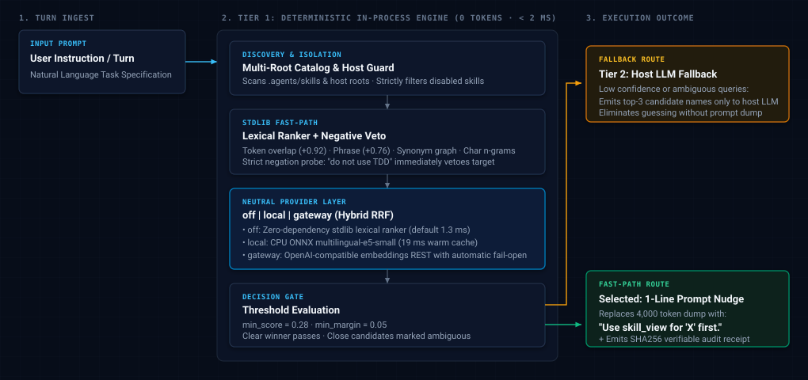
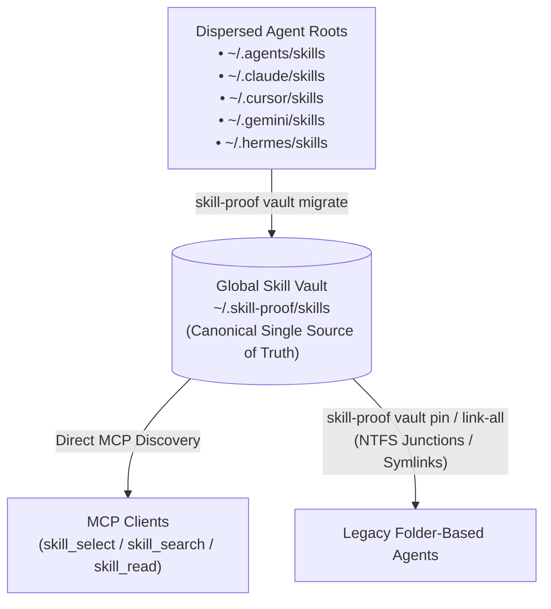
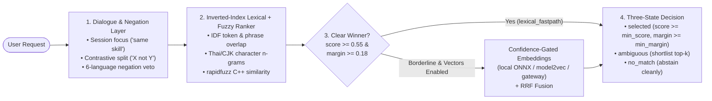
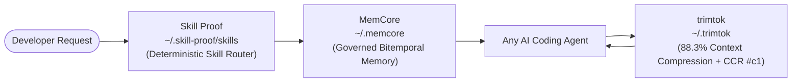

<div align="center">

# Skill Proof

**Global Skill Vault & Deterministic In-Process Skill Router for AI Coding Agents**

<p><em>Zero routing model calls. Unified <code>~/.skill-proof/skills</code> vault. Sub-millisecond lexical, fuzzy & local vector routing over stdio MCP.</em></p>

<p>
  <a href="https://github.com/Stxyu-p/skill-proof"></a>
  <a href="LICENSE"></a>
  
  <a href="#quick-start"></a>
  <a href="#the-global-skill-vault-skill-proofskills"></a>
  <a href="#mcp-server--universal-client-installer"></a>
</p>

<p>
  <a href="#why-skill-proof">Why Skill Proof</a> ·
  <a href="#live-routing-showcase">Live Routing</a> ·
  <a href="#the-global-skill-vault-skill-proofskills">Global Skill Vault</a> ·
  <a href="#quick-start">Quick Start</a> ·
  <a href="#how-two-tier-routing-works">How It Works</a> ·
  <a href="#architecture--key-modules">Architecture</a> ·
  <a href="#mcp-server--universal-client-installer">MCP & Clients</a> ·
  <a href="#cli-hermes--configuration-reference">CLI & Config</a> ·
  <a href="#recommended-ecosystem-combo">Trinity Combo</a>
</p>

</div>

---

## Why Skill Proof?

As your `SKILL.md` library grows across coding agents, two compounding bottlenecks emerge:
1. **Fragmented Multi-Folder Chaos:** Skills get duplicated across `.agents/skills`, `.claude/skills`, `.cursor/skills`, `.codex/skills`, `.gemini/skills`, and `~/.hermes/skills` — wasting disk space and drifting out of sync whenever you improve a skill.
2. **System Prompt Bloat & Routing Uncertainty:** Stuffing 100+ skill descriptions into every system prompt burns thousands of tokens per turn, while calling a secondary LLM to pick a skill adds latency, cost, and nondeterministic guesses.

**Skill Proof solves both problems 100% locally and in-process:**

- **Global Skill Vault (`~/.skill-proof/skills`):** Consolidates dispersed physical skills into one canonical global vault (`vault.json`) and links them cleanly into legacy client folders via NTFS junctions or POSIX symlinks.
- **Deterministic Zero-LLM Routing:** Scores every skill in `< 1 ms` using a pre-computed inverted index, `rapidfuzz` C++ token alignment, character n-grams for spaceless scripts (Thai, CJK), contrastive clause splitting (`"use X instead of Y"`), 6-language negation vetoes (`"do not use TDD"`), and confidence-gated local embeddings (`model2vec` / ONNX).
- **Tamper-Evident Audit & Tool Gates:** Emits SHA-256 hash-chained selection receipts (`audit.jsonl`) storing derived numbers only (never prompts or secrets) and optionally enforces tool gates until the required skill is loaded.

| Cost of a Large Skill Catalog | Without Skill Proof | With Skill Proof |
| :--- | :--- | :--- |
| **Skill Storage** | Duplicated across `.agents`, `.claude`, `.cursor`, `.gemini`, `.hermes` | **One canonical vault (`~/.skill-proof/skills`)** shared by all agents |
| **Routing Execution** | Extra LLM call or full-catalog prompt reasoning | **Zero model calls** — deterministic in-process scoring in `< 1 ms` |
| **System Prompt Size** | Every skill name & description stays in the system prompt | Confident selection can replace the full index for that turn (`reduce_skill_prompt`) |
| **Negative Constraints** | `"do not use X"` often ignored by keyword matchers | **6-language Negation Veto** strips vetoed skills before scoring |
| **Vague / Ambiguous Queries** | Model guesses and activates the wrong workflow | Conservative margin gate returns `ambiguous` shortlist or `no_match` |
| **Auditability** | Opaque model choice with no provenance | **SHA-256 hash-chained receipts** + `/skill-proof why <skill>` breakdown |



---

## Live Routing Showcase

### 1. Explicit Negation Veto + Contrastive Routing + Fleet Agent Hint
Notice how `"do not use TDD"` vetoes `test-driven-development` before ranking, selects `github-code-review`, attaches `github-pr-workflow` as a companion skill, and recommends the `altima` reviewer agent:

```bash
$ skill-proof select --query "Review this pull request for syntax bugs, but do not use TDD"
decision: selected (lexical_match)
suggested fleet agent: altima
selected: github-code-review score=0.940715 reasons=alias_phrase,name_terms,tag_terms,alias_terms,description_terms companions=github-pr-workflow
candidate: github-code-review score=0.940715 reasons=alias_phrase,name_terms,tag_terms,alias_terms,description_terms
candidate: code-review score=0.876008 reasons=alias_phrase,name_terms,alias_terms,description_terms
candidate: github-pr-workflow score=0.852364 reasons=alias_phrase,tag_terms,alias_terms
```

### 2. Natural-Language Symptom Routing (Zero Exact Skill-Name Tokens)
Even when the user describes a symptom (`"my page keeps crashing after login"`) without naming any skill, synonym bridges and morphology routing resolve the exact debugging playbook and companion test skill:

```bash
$ skill-proof select --query "my page keeps crashing after login"
decision: selected (lexical_match)
suggested fleet agent: sora
selected: systematic-debugging score=0.796145 reasons=alias_phrase,alias_terms companions=test-driven-development
candidate: systematic-debugging score=0.796145 reasons=alias_phrase,alias_terms
candidate: planning-with-files score=0.076061 reasons=description_terms
candidate: caveman score=0.035353 reasons=description_terms
```

---

## The Global Skill Vault (`~/.skill-proof/skills`)

Instead of scattering skill copies across every IDE and CLI, **Skill Proof** places `~/.skill-proof/skills` at the top of the root discovery hierarchy (`vault` root):



```bash
# 1. Migrate all physical skills from detected agent roots into ~/.skill-proof/skills
skill-proof vault migrate

# 2. Inspect global vault inventory and per-client linkage health
skill-proof vault status

# 3. Pin a specific skill (or link all vault skills) into a client directory via NTFS junction / symlink
skill-proof vault pin --skill systematic-debugging --to ~/.claude/skills
skill-proof vault link-all --to ~/.cursor/skills
```

> [!NOTE]
> **Safe Reparse & Zero-Data-Loss Guarantees:**
> - Junctions and symlinks pointing into `~/.skill-proof/skills` are automatically whitelisted by the catalog scanner (`unsafe_reparse = 0`).
> - `skill-proof vault unpin` refuses to delete physical directories.
> - `skill-proof vault pin` and `vault link-all` never overwrite an existing physical directory unless `--force` is explicitly provided.

---

## Quick Start

### 1. Universal One-Command Auto-Install (Recommended)

Install `skill-proof`, register its stdio MCP server across all detected AI coding clients, and consolidate your skills into the global vault:

```bash
pip install skill-proof-router
skill-proof install
skill-proof vault migrate
```

`skill-proof install` detects and atomically updates:
- **Claude Code** (`~/.claude.json`) & **Claude Desktop** (`claude_desktop_config.json`)
- **Google Antigravity & Antigravity IDE** (`~/.gemini/config/mcp_config.json`, `~/.gemini/antigravity/mcp_config.json`)
- **Gemini CLI** (`~/.gemini/settings.json`) & **Codex CLI** (`~/.codex/config.toml`)
- **Cursor** (`~/.cursor/mcp.json`), **Windsurf**, **VS Code (Copilot)**, **OpenCode**, and **Cline**

Verify client registration and catalog state:

```bash
skill-proof clients
skill-proof status
skill-proof scan
```

### 2. Hermes Agent Native Plugin

```bash
# Linux / macOS
git clone https://github.com/Stxyu-p/skill-proof.git ~/.hermes/plugins/skill-proof

# Windows (PowerShell)
git clone https://github.com/Stxyu-p/skill-proof.git "$env:LOCALAPPDATA\hermes\plugins\skill-proof"

hermes plugins enable skill-proof
```

---

## How Two-Tier Routing Works



### Three-State Decision Rules

- **`selected` (Clear Winner):** Top candidate meets `min_score` (default `0.28`) AND leads the runner-up by at least `min_margin` (default `0.05`). When `score >= 0.55` and `margin >= 0.18`, the embedding layer is bypassed entirely (`provider_used=lexical_fastpath`).
- **`ambiguous` (Close Runner-Up):** Multiple candidates cluster within `min_margin`. Skill Proof returns a shortlist of up to `max_candidates` (default `3`) instead of guessing.
- **`no_match` (Clean Abstention):** Nothing clears threshold. Skill Proof abstains so an unrelated skill is never forced onto a turn.

---

## Architecture & Key Modules

| Module | Role | Technical Advantage |
| :--- | :--- | :--- |
| `skill_proof/core.py` | **Engine Facade** | Turn lifecycle, session memory, SHA-256 hash-chained receipts, and shared `SkillProofEngine.from_config` factory. |
| `skill_proof/vault.py` | **Global Skill Vault** | Manages `~/.skill-proof/skills` and `vault.json`; implements `migrate`, `pin`, `unpin`, `sync`, and `link-all` via NTFS junctions / POSIX symlinks. |
| `skill_proof/_catalog.py` | **Multi-Root Discovery** | Prioritizes `~/.skill-proof/skills` (`vault` root), TTL-caches scans (`catalog_cache_ttl_ms`), validates frontmatter invariants, and filters disabled skills. |
| `skill_proof/_ranking.py` | **Lexical & Fuzzy Ranker** | Pre-computed inverted index, English morphology stemmer, Thai/CJK character n-grams, `rapidfuzz` C++ fuzzy matching, and companion skill handoff. |
| `skill_proof/_dialogue.py` | **Conversational Focus & Veto** | Multi-turn session focus, reference resolution (`"same skill as before"`), contrastive splitting (`"use X instead of Y"`), and 6-language negation vetoes. |
| `skill_proof/_vector.py` | **Confidence-Gated Vectors** | Runs `local` (`model2vec` / ONNX) or `gateway` embeddings with RRF fusion *only* when lexical ranking is borderline. |
| `skill_proof/_compliance.py` | **Policy Store & Calibration** | Enforce-mode tool gates (`active_turn.json`) and audit-driven threshold calibration (`calibrate_audit`). |
| `skill_proof/bridge.py` | **Host Hook Bridge** | Removable `PreToolUse` / `AGENTS.md` / `.cursor/rules` bridge for external harnesses. |
| `skill_proof/mcp_server.py` | **Stdio MCP Server** | Exposes `skill_roots`, `skill_scan`, `skill_select`, `skill_search`, and `skill_read` over JSON-RPC 2.0. |
| `skill_proof/mcp_install.py` | **Universal Client Installer** | Atomically registers/unregisters `skill-proof` across 11 AI agent CLIs and IDEs with `.pre-mcp-install.bak` backups. |

### System Footprint & Speed

| Property | Measured Value |
| :--- | :--- |
| **Routing Model Calls** | **0** (100% deterministic in-process scoring) |
| **Warm Catalog Scan (300 skills)** | **~0.02 ms** per turn (TTL-cached) |
| **Non-Matching Query Pruning** | **0.2 – 0.3 ms** via pre-computed inverted index |
| **Full Routing Median (300-skill catalog)** | **~6.0 ms** in a single Python process |
| **Embedding Work on Clear Lexical Winner** | **Skipped (`0 ms`)** via `lexical_fastpath` |

---

## MCP Server & Universal Client Installer

When registered via `skill-proof install`, any MCP-capable host gains five deterministic tools:

| MCP Tool | Purpose |
| :--- | :--- |
| **`skill_roots`** | List all active skill root directories (led by `~/.skill-proof/skills`) and their precedence order. |
| **`skill_scan`** | Scan all roots and return total skill count, diagnostic counts, and root health. |
| **`skill_select`** | Return a deterministic routing decision (`selected`, `ambiguous`, or `no_match`), top candidates, companions, and suggested fleet agent. |
| **`skill_search`** | Hybrid lexical + semantic RRF top-$k$ search across skill names, tags, aliases, and descriptions. |
| **`skill_read`** | Load the full `SKILL.md` body for a selected skill on demand instead of bloating the base system prompt. |

---

## CLI, Hermes & Configuration Reference

| CLI Subcommand | Purpose |
| :--- | :--- |
| `skill-proof select "<query>"` | Choose one skill deterministically for a query (`--json` for structured output). |
| `skill-proof eval "<query>"` | Interactive query diagnostics: token breakdown, n-grams, explicit matches, and full ranking matrix. |
| `skill-proof vault <action>` | Manage `~/.skill-proof/skills` (`status`, `migrate`, `pin`, `unpin`, `sync`, `link-all`). |
| `skill-proof install` / `clients` / `uninstall` | Register, inspect, or remove the stdio MCP server across all 11 supported AI clients. |
| `skill-proof scan` / `roots` | Scan all detected roots and report catalog diagnostics. |
| `skill-proof overlap` | Detect near-duplicate or overlapping skills worth pruning across roots. |
| `skill-proof calibrate` | Compute threshold and synonym tuning suggestions from `audit.jsonl`. |
| `skill-proof models` / `setup` / `prefetch` | Inspect, configure, or checksum-download local embedding models. |
| `skill-proof bridge` | Install or remove optional host hook bridges (`status`, `init`, `remove`, `ai-setup`). |

<details>
<summary><strong>⚙️ Click to expand: Full Hermes Plugin Commands & Configuration Schema</strong></summary>

<br/>

### In-Session Slash Commands (Hermes)

| Command | Purpose |
| :--- | :--- |
| `/skill-proof status` | Compact turn state, catalog size, and provider status. |
| `/skill-proof why <name>` | Full scoring explanation for why a skill won, lost, or was vetoed. |
| `/skill-proof stats` | Per-skill hit rates, misses, and overrides aggregated from `audit.jsonl`. |
| `/skill-proof calibrate` | Data-driven threshold and weight suggestions from audit history. |
| `/skill-proof audit-verify` | Verify the cryptographic SHA-256 `prev_sha256` hash chain of `audit.jsonl`. |
| `/skill-proof overlap` | Near-duplicate detection paired with actual audit load counts. |
| `/skill-proof trace` | Full bounded JSON receipt for the current turn. |
| `/skill-proof refresh` | Force an immediate catalog rescan on the next turn. |
| `/skill-proof health` | Self-check across catalog diagnostics, hook activity, and timing. |

### Configuration Settings (`config.yaml`)

```yaml
plugins:
  enabled:
    - skill-proof
  entries:
    skill-proof:
      settings:
        mode: nudge                       # nudge (default), observe, or enforce-tools
        reduce_skill_prompt: false        # opt-in; confident selection replaces the full index
        embedding_provider: off           # off (default), local, or gateway
        embedding_model: Xenova/multilingual-e5-small
        min_score: 0.28
        min_margin: 0.05
        catalog_cache_ttl_ms: 1000        # reuse host-filtered catalog within TTL window
        block_modified_hub_skills: false  # exclude hub skills whose bundle SHA-256 changed
        session_memory: true              # resolve follow-ups like "use the same skill"
        audit_log: true                   # append derived-numbers hash-chained audit records
```

</details>

---

## Recommended Ecosystem Combo

While **Skill Proof** works standalone as your skill vault and deterministic router, pairing it with [**MemCore**](https://github.com/Stxyu-p/memcore) and [**trimtok**](https://github.com/Stxyu-p/trimtok) completes the **Global Agent Trinity** — uniting every AI coding client on your machine (**Claude Code, Cursor, Antigravity, Gemini CLI, Codex, VS Code Copilot, Windsurf, OpenCode, Cline, and Hermes**) around three shared local hubs:



| Pillar | Repository | Global Hub | What Installing All 3 Gives You |
| :--- | :--- | :--- | :--- |
| **Skill Vault & Router** | **[Skill Proof](https://github.com/Stxyu-p/skill-proof)** | `~/.skill-proof/skills` | Consolidates all dispersed `SKILL.md` playbooks into **one deduplicated global vault** and routes tasks in `< 1 ms` with zero routing LLM calls. |
| **Governed Memory** | **[MemCore](https://github.com/Stxyu-p/memcore)** | `~/.memcore` | Gives every IDE and CLI **one shared bitemporal brain** (`FTS5` + `sqlite-vec` SIMD + `model2vec`) with hard trust boundaries and source-file staleness tracking. |
| **Context Shield** | **[trimtok](https://github.com/Stxyu-p/trimtok)** | `~/.trimtok` | Cuts terminal, traceback, diff, AST code, and JSON token bloat by **88.3%** with instant `#c1` lossless recovery. |

```bash
# Install & link the complete Global Agent Trinity across all your IDEs and CLIs
pip install skill-proof-router memcore trimtok
skill-proof install && memcore init && memcore install && trimtok install
skill-proof vault migrate
```

---

## Verification & License

```bash
# Run the complete 383-test offline verification suite + routing & latency gates
pytest -q
python routing_benchmark.py --gate
python phase3_gates.py
```

Distributed under the [MIT License](LICENSE). Designed and maintained by **P Choke & SORA**.
