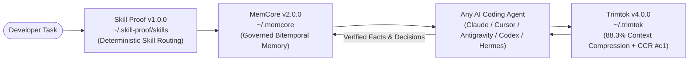

<div align="center">

# Skill Proof

**Deterministic In-Process Skill Router & Global Skill Vault for AI Coding Agents**

<p><em>Zero routing model calls. Unified <code>~/.skill-proof/skills</code> vault. Sub-millisecond lexical + local vector routing over stdio MCP.</em></p>

<p>
  <a href="https://github.com/Stxyu-p/skill-proof"></a>
  <a href="LICENSE"></a>
  
  <a href="#quick-start"></a>
  <a href="#global-skill-vault-skill-proofskills"></a>
  <a href="#mcp-server--universal-client-installer"></a>
</p>

<p>
  <a href="#overview">Overview</a> ·
  <a href="#the-global-agent-trinity-recommended-combo">Global Trinity Combo</a> ·
  <a href="#global-skill-vault-skill-proofskills">Global Skill Vault</a> ·
  <a href="#quick-start">Quick Start</a> ·
  <a href="#architecture--key-modules">Architecture</a> ·
  <a href="#mcp-server--universal-client-installer">MCP & Clients</a> ·
  <a href="#cli--hermes-commands">CLI Reference</a>
</p>

</div>

---

## Overview

A large `SKILL.md` catalog creates two compounding problems across AI coding tools:
1. **Fragmented Duplication:** Skills get copied across `.agents/skills`, `.claude/skills`, `.cursor/skills`, `.codex/skills`, `.gemini/skills`, and `~/.hermes/skills`, quickly drifting out of sync.
2. **Prompt Bloat & Routing Latency:** Loading 100+ skill descriptions into every system prompt wastes thousands of tokens per turn, while delegating skill selection to an extra LLM call adds latency and nondeterminism.

**Skill Proof v1.0.0** solves both in-process:
- **Global Skill Vault (`~/.skill-proof/skills`):** Consolidates all physical skills into one canonical global vault (`vault.json`) and links them cleanly via NTFS junctions / POSIX symlinks.
- **Deterministic Sub-Millisecond Routing:** Scores every skill against the user request using an inverted index, `rapidfuzz` C++ fuzzy matching, character n-grams for spaceless scripts (Thai, CJK), multilingual negation vetoes (`"do not use X"`), and optional local embeddings (`model2vec` / ONNX) — returning **`selected`**, **`ambiguous`**, or **`no_match`** with **zero LLM calls**.

```bash
$ skill-proof select --query "Review this pull request for syntax bugs, but do not use TDD"
decision: selected (lexical_match)
suggested fleet agent: altima
selected: github-code-review score=0.940715 reasons=alias_phrase,name_terms,tag_terms,alias_terms,description_terms companions=github-pr-workflow
candidate: github-code-review score=0.940715 reasons=alias_phrase,name_terms,tag_terms,alias_terms,description_terms
candidate: code-review score=0.876008 reasons=alias_phrase,name_terms,alias_terms,description_terms
candidate: github-pr-workflow score=0.852364 reasons=alias_phrase,tag_terms,alias_terms
```


---

## The Global Agent Trinity (Recommended Combo)

For the complete local-first AI engineering stack, pair **Skill Proof** with [**MemCore**](https://github.com/Stxyu-p/memcore) and [**Trimtok**](https://github.com/Stxyu-p/trimtok). Together, they unify every AI coding client on your machine (**Claude Code, Cursor, Antigravity, Gemini CLI, Codex, VS Code Copilot, Windsurf, OpenCode, Cline, and Hermes**) around three shared global hubs:



| Layer | Engine | Global Hub | What You Gain When Installed Together |
| :--- | :--- | :--- | :--- |
| **1. Skill Routing** | [**Skill Proof v1.0.0**](https://github.com/Stxyu-p/skill-proof) | `~/.skill-proof/skills` | **One Skill Vault, Zero Prompt Bloat:** Deduplicates all `SKILL.md` playbooks into one global vault and selects the right skill in `< 1 ms` with zero routing LLM calls. |
| **2. Governed Memory** | [**MemCore v2.0.0**](https://github.com/Stxyu-p/memcore) | `~/.memcore` | **One Shared Brain Across All Clients:** Hybrid FTS5 + `sqlite-vec` SIMD + `model2vec` recall with bitemporal versioning, source-hash staleness detection, and tombstone guards. |
| **3. Context Shield** | [**Trimtok v4.0.0**](https://github.com/Stxyu-p/trimtok) | `~/.trimtok` | **88.3% Less Context Noise:** Compresses noisy terminal logs, tracebacks, diffs, AST code bodies, and JSON tool outputs while keeping every byte recoverable via `#c1` aliases. |

### One-Command Trinity Setup

```bash
# 1. Install all three engines
pip install skill-proof memcore trimtok

# 2. Register stdio MCP servers across all detected AI coding clients & IDEs
skill-proof install
memcore install
trimtok install

# 3. Migrate dispersed agent skills into the global vault (~/.skill-proof/skills)
skill-proof vault migrate
```

---

## Global Skill Vault (`~/.skill-proof/skills`)

Instead of maintaining separate copies of skills inside `.agents/skills`, `.claude/skills`, `.cursor/skills`, and `~/.hermes/skills`, **Skill Proof v1.0.0** elevates `~/.skill-proof/skills` to the highest-priority `vault` root across all agents:

```bash
# 1. Migrate physical skills from all detected agent roots into ~/.skill-proof/skills
skill-proof vault migrate

# 2. Inspect global vault health and per-client linkage counts
skill-proof vault status

# 3. Pin a specific skill (or all vault skills) to a legacy client root via NTFS junction / symlink
skill-proof vault pin --skill systematic-debugging --to ~/.claude/skills
skill-proof vault link-all --to ~/.cursor/skills
```

- **Safe Reparse Traversal:** Skills inside `~/.skill-proof/skills` and junctions pointing into the vault are automatically whitelisted by the catalog scanner (`unsafe_reparse = 0`).
- **Zero Data Loss Guarantees:** `vault unpin` refuses to delete physical directories, and `vault pin` / `vault link-all` never overwrite an existing physical directory unless `--force` is explicitly passed.

---

## Quick Start

### 1. Universal Package & MCP Auto-Install (Recommended)

```bash
pip install skill-proof
skill-proof install
skill-proof vault migrate
```

`skill-proof install` detects and atomically registers the `skill-proof` stdio MCP server into:
- **Claude Code** (`~/.claude.json`) & **Claude Desktop** (`claude_desktop_config.json`)
- **Google Antigravity & Antigravity IDE** (`~/.gemini/config/mcp_config.json`, `~/.gemini/antigravity/mcp_config.json`)
- **Gemini CLI** (`~/.gemini/settings.json`) & **Codex CLI** (`~/.codex/config.toml`)
- **Cursor** (`~/.cursor/mcp.json`), **Windsurf**, **VS Code (Copilot)**, **OpenCode**, and **Cline**

Verify client registration and catalog state:

```bash
skill-proof clients
skill-proof status
skill-proof scan
```

### 2. Hermes Agent Native Plugin

```bash
# Linux / macOS
git clone https://github.com/Stxyu-p/skill-proof.git ~/.hermes/plugins/skill-proof

# Windows (PowerShell)
git clone https://github.com/Stxyu-p/skill-proof.git "$env:LOCALAPPDATA\hermes\plugins\skill-proof"

hermes plugins enable skill-proof
```

---

## Architecture & Key Modules

`skill-proof v1.0.0` is packaged under `skill_proof/` with lightweight root-level forwarding shims so both standard `pip` entry points (`skill-proof`, `skill-proof-mcp`) and Hermes plugin hooks execute the exact same engine instance:

| Module | Role | Technical Advantage |
| :--- | :--- | :--- |
| `skill_proof/core.py` | **Engine Facade** | Turn lifecycle, session memory, SHA-256 hash-chained receipts, and shared `SkillProofEngine.from_config` factory. |
| `skill_proof/vault.py` | **Global Skill Vault** | Manages `~/.skill-proof/skills` and `vault.json`; handles `migrate`, `pin`, `unpin`, `sync`, and `link-all` via NTFS junctions / POSIX symlinks. |
| `skill_proof/_catalog.py` | **Multi-Root Discovery** | Prioritizes `~/.skill-proof/skills` (`vault` root), TTL-caches scans, validates frontmatter invariants, and filters host-disabled skills. |
| `skill_proof/_ranking.py` | **Lexical & Fuzzy Ranker** | Inverted index, morphology normalization, character n-grams for Thai/CJK, `rapidfuzz` C++ fuzzy matching, and companion skill handoff. |
| `skill_proof/_dialogue.py` | **Conversational Focus & Veto** | Multi-turn session focus, reference resolution (`"same skill as before"`), contrastive splitting (`"use X instead of Y"`), and 6-language negation vetoes. |
| `skill_proof/_vector.py` | **Confidence-Gated Vectors** | Runs `local` (`model2vec` / ONNX) or `gateway` embeddings with RRF fusion *only* when lexical ranking is borderline (`lexical_fastpath` bypass). |
| `skill_proof/_compliance.py` | **Policy Store & Calibration** | Enforce-mode tool gates (`active_turn.json`) and audit-driven threshold calibration (`calibrate_audit`). |
| `skill_proof/mcp_server.py` | **Stdio MCP Server** | Exposes `skill_roots`, `skill_scan`, `skill_select`, `skill_search`, and `skill_read` over JSON-RPC 2.0. |
| `skill_proof/mcp_install.py` | **Universal Client Installer** | Atomically registers/unregisters `skill-proof` across 11 AI agent CLIs and IDEs with `.pre-mcp-install.bak` backups. |

### System Footprint & Speed

| Property | Measured Value |
| :--- | :--- |
| **Routing Model Calls** | **0** (100% deterministic in-process scoring) |
| **Warm Catalog Scan (300 skills)** | **~0.02 ms** per turn (TTL-cached) |
| **Non-Matching Query Pruning** | **0.2 – 0.3 ms** via pre-computed inverted index |
| **Full Routing Median (300-skill catalog)** | **~6.0 ms** in a single Python process |
| **Embedding Bypass on Clear Lexical Winner** | **Skipped (`0 ms`)** when `score >= 0.55` and `margin >= 0.18` |

---

## MCP Server & Universal Client Installer

When registered via `skill-proof install`, any MCP-capable host gains five deterministic tools:

| MCP Tool | Purpose |
| :--- | :--- |
| **`skill_roots`** | List all active skill root directories (including `~/.skill-proof/skills`) and their precedence order. |
| **`skill_scan`** | Scan all roots and return total skill count, diagnostic counts, and root health. |
| **`skill_select`** | Return a deterministic routing decision (`selected`, `ambiguous`, or `no_match`), top candidates, and suggested fleet agent. |
| **`skill_search`** | Hybrid lexical + semantic RRF top-$k$ search across skill names, tags, aliases, and descriptions. |
| **`skill_read`** | Load the full `SKILL.md` body for a selected skill on demand instead of bloating the base system prompt. |

---

## CLI & Hermes Commands

```bash
# Routing & Diagnostics
skill-proof select --query "Analyze and optimize database SQL query performance"
skill-proof eval "Design a clean responsive web dashboard"
skill-proof overlap --min-similarity 0.4
skill-proof calibrate --json

# Global Skill Vault Management
skill-proof vault status
skill-proof vault migrate
skill-proof vault pin --skill code-review --to ~/.claude/skills
skill-proof vault link-all --to ~/.cursor/skills

# MCP Client Registration
skill-proof install
skill-proof clients
skill-proof uninstall

# Local Embedding Model Management
skill-proof models
skill-proof setup --provider local --prefetch
```

### Verification Suite

```bash
# Run the complete 383-test suite (unit + property + routing benchmark + phase-3 gates)
pytest -q
python routing_benchmark.py --gate
python phase3_gates.py
```

---

## License

Distributed under the [MIT License](LICENSE) © **P Choke & SORA**.
