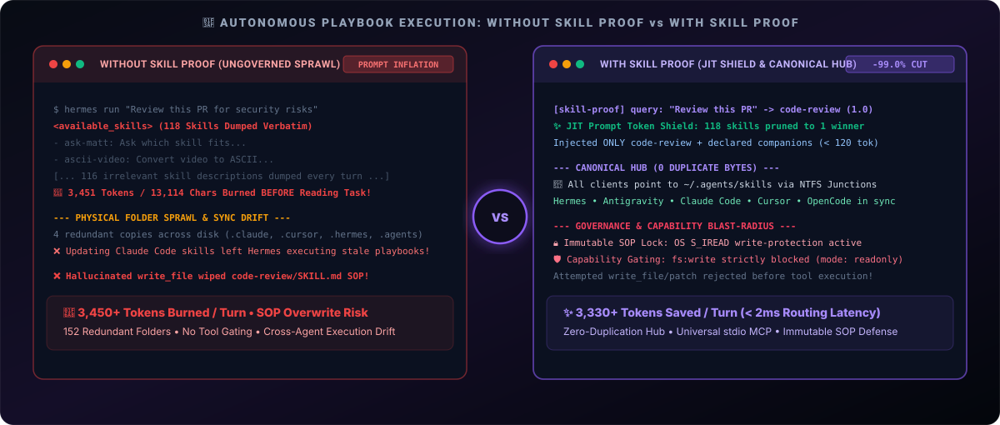

<h1 align="center">🎯 Skill Proof</h1>

<p align="center">
  <strong>Zero-dependency deterministic skill router, canonical vault &amp; governance gatekeeper for autonomous AI fleets</strong>
</p>

<p align="center">
  <a href="https://pypi.org/project/skill-proof-router/"></a>
  <a href="https://www.python.org/"></a>
  <a href="pyproject.toml"></a>
  <a href="#mcp-tools"></a>
  <a href="LICENSE"></a>
</p>

<p align="center">
  <a href="#quick-start">Quick Start</a> ·
  <a href="#architecture">Architecture</a> ·
  <a href="#capabilities">Capabilities</a> ·
  <a href="#cli-reference">CLI</a> ·
  <a href="#mcp-tools">MCP &amp; Hermes</a> ·
  <a href="#verification">Verification</a>
</p>

<p align="center">
  
</p>

Managing `SKILL.md` playbooks across multiple AI coding clients breaks quickly: copied skill folders drift out of sync, dumping full skill catalogs into every prompt wastes context, and autonomous agents can accidentally overwrite instructions or save compressed `[tt:...]` stubs back into playbooks.

**Skill Proof** solves this **100% standalone using only the Python standard library**: one canonical vault (`~/.agents/skills`), deterministic offline skill routing, stub-corruption and drift diagnostics, immutable SOP locks, and cross-client MCP + CLI tooling.

---

<a id="architecture"></a>
## Architecture

```text
                       ~/.agents/skills  (Canonical Vault)
                                       │
          ┌────────────────────────────┼────────────────────────────┐
          ▼                            ▼                            ▼
   .claude/skills               .gemini/skills          Hermes / Cursor / OpenCode
          │                            │                            │
          └──────────────┬─────────────┴────────────────────────────┘
                         ▼
         [ skill-proof CLI / 8-Tool stdio MCP Server ]
           ├── Deterministic Lexical Router (stdlib inverted index + BM25)
           ├── Stub-Corruption & Cross-Root Drift Scanner (doctor --json)
           ├── Read-Only Veto & Fleet Filters ($SKILL_PROOF_VETO_FILE / config)
           └── Closed-Loop Graduation (crystallize --from-candidates JSONL)
```

---

<a id="capabilities"></a>
## Core Capabilities

| Capability | Implementation | Why It Matters |
| :--- | :--- | :--- |
| **Canonical Vault & Junction Reconciler** | Consolidates skills at `~/.agents/skills`, fans out via OS junctions/symlinks, blocks self-loop targets, and checks SHA-256 drift across roots (`vault reconcile` / `vault status`). | One source of truth across Claude Code, Codex, Gemini, Antigravity, Cursor, OpenCode, and Hermes. |
| **Stub-Corruption & Immutable SOP Guard** | Detects persisted `[tt:...]` / `#ref` compression stubs inside `SKILL.md` (`stub_corrupted`), protects `immutable: true` skills, and toggles OS read-only attributes (`vault lock` / `unlock`). | Stops corrupted compression placeholders or unwanted edits from ruining agent playbooks. |
| **Zero-Dependency Lexical Router** | Pure Python stdlib tokenizer, inverted index, synonym expansion, and 6-language negation veto (`off` vector default). | Fast, deterministic local routing without downloading ML weights or running background servers. |
| **Fail-Open Optional Vector Reranking** | Optional `local` (`model2vec`/`tokenizers`) or OpenAI-compatible `gateway` reranking via SQLite vector cache; opens read-only when `provider=off` and fails open to lexical routing on DB errors. | Adds semantic recall if desired while keeping `select`, `search`, and `doctor` crash-proof. |
| **Cross-Host Capability & Prerequisite Gating** | Enforces `mode: readonly`, `forbidden_capabilities` (`fs:write`, `shell:exec`, `skill:manage`), and `required_binaries` preflight checks. | Prevents playbooks from invoking disallowed tools or failing mid-run on missing binaries. |
| **Closed-Loop Graduation & Mining** | `crystallize --from-candidates` ingests `skill-proof.candidate.v1` JSONL (with `--dry-run`, `--json`, and stub checks); `mine` / `--from-traces` extracts repeatable workflows tagged `[EXTRACTED]` / `[INFERRED]`. | Promotes proven lessons and traces into versioned `SKILL.md` files with explicit provenance. |
| **Standalone Health & Honest Audit** | `doctor --json` checks vault integrity, stub corruption, drift, audit log health, read-only vector state, and optional Hermes integration (`status: "info"` when absent). | Clean machine-readable health contract; works identically with or without peer tools. |

---

<a id="quick-start"></a>
## Quick Start

```bash
pip install skill-proof-router
# Optional: enable local semantic vectors alongside the zero-dependency lexical router
pip install "skill-proof-router[vectors]"

# 1. Initialize or reconcile ~/.agents/skills across detected clients
skill-proof vault reconcile

# 2. Check vault health, stub corruption, drift, and optional integrations
skill-proof doctor --json

# 3. Register the 8-tool stdio MCP server in detected AI CLIs
skill-proof install
skill-proof clients
```

---

<a id="cli-reference"></a>
## CLI & Standalone Configuration

### Common Commands

```bash
# Vault health, link status, immutable SOP locks & local upstream patches
skill-proof doctor --json
skill-proof vault status --json
skill-proof vault reconcile --dry-run
skill-proof vault lock <skill-name>
skill-proof vault unlock <skill-name>
skill-proof vault patch --patch-op rebase

# Route queries, inspect structure progressively, and check overlap
skill-proof select "debug sqlite wal lock on windows" --json
skill-proof read <skill-name> --level outline

# Closed-loop skill creation (from MemCore JSONL candidates or usage traces)
skill-proof crystallize --from-candidates candidates.jsonl --dry-run --json
skill-proof mine --from-traces --min-runs 3 --dry-run

# Inspect retained audit log & dry-run unused skill candidates
skill-proof audit stats
skill-proof audit prune --dry-run
skill-proof audit prune --apply

# Export cross-agent handoff brief or inject rules into AGENTS.md / CLAUDE.md / GEMINI.md
skill-proof handoff --target antigravity
skill-proof compile
```

> **Honest Audit Boundaries:** `audit prune` reports skills absent from the retained audit window—it is non-mutating unless `--apply` is passed and refuses to prune on missing or corrupt logs. Adjacent `prev_sha256` hash links verify continuity only within the unrotated portion of `audit.jsonl`.

### Standalone Environment Variables

| Variable | Purpose | Default |
| :--- | :--- | :--- |
| `SKILL_PROOF_VAULT` | Override canonical skill vault path | `~/.agents/skills` |
| `SKILL_PROOF_VETO_FILE` | Neutral JSON file for persistent negative skill vetoes | `~/.agents/skill-vetoes.json` |
| `SKILL_PROOF_MEMCORE_DB` | Explicit opt-in path to a MemCore SQLite DB for cross-tool vetoes & handoffs | Unset (disabled) |
| `SKILL_PROOF_FLEET_PROFILES` | Custom fleet agent-routing profile JSON overlay or path | Built-in `"default"` fallback |
| `SKILL_PROOF_EMBEDDING_PROVIDER` | `off` (stdlib lexical), `local`, or `gateway` | `off` |
| `SKILL_PROOF_VECTOR_DB` | SQLite vector cache path (when vector provider enabled) | `<hermes_home>/plugin-data/skill-proof/embeddings.db` |
| `SKILL_PROOF_AUDIT_PATH` | Override append-only `audit.jsonl` path | Uses `SKILL_PROOF_DATA_DIR` / Hermes data dir if present |

---

<a id="mcp-tools"></a>
## MCP Server (8 Tools) & Optional Hermes Integration

`skill-proof install` registers the stdio JSON-RPC MCP server across detected clients (Claude Code, Codex CLI, Gemini CLI, Antigravity, Cursor, Windsurf, VS Code, OpenCode, Cline).

| MCP Tool | Purpose |
| :--- | :--- |
| `skill_roots` | List detected skill root directories across local agent clients |
| `skill_scan` | Scan catalog health, diagnostics (`stub_corrupted`, `shadowed_by_root`), and catalog hash |
| `skill_select` | Select the top matching skill for a query (with optional inline `include_content`) |
| `skill_search` | Return top-K matching skill candidates and scores |
| `skill_read` | Load a skill by `outline` or `full` content level |
| `skill_doctor` | Return the structured `doctor --json` health report over MCP |
| `skill_vault_status` | Report canonical vault skills, per-client link state, drift, and broken links |
| `skill_overlap` | Inspect duplicate or overlapping skill definitions across roots |

### Optional Hermes Native Plugin

When running inside Hermes Agent, clone into your Hermes plugins directory for native hooks (`pre_llm_call`, `pre_tool_call`, `post_tool_call`, `transform_llm_output`, `post_llm_call`, `on_skill_lifecycle`, `on_session_end`), automatic JIT prompt shrinking (`reduce_skill_prompt: true`), and slash commands (`/skill-proof status`, `/skill-proof explain`, `/skill-proof why <skill>`, `/skill-proof stats`, `/skill-proof audit-verify`, `/skill-proof refresh`):

```bash
# Windows (PowerShell)
git clone https://github.com/Stxyu-p/skill-proof.git "$env:LOCALAPPDATA\hermes\plugins\skill-proof"

# Linux / macOS
git clone https://github.com/Stxyu-p/skill-proof.git ~/.hermes/plugins/skill-proof

hermes plugins enable skill-proof
```

---

## Standalone or Ecosystem

Runs standalone out of the box, or pairs cleanly via explicit files/pipes with its zero-daemon companions:

| Pillar | Hub | Role |
| :--- | :--- | :--- |
| **[trimtok](https://github.com/Stxyu-p/trimtok)** | `~/.trimtok` | In-process context compression, `#ref` CCR vault & `[tt:...]` write-safety guard |
| **[MemCore](https://github.com/Stxyu-p/memcore)** | `~/.memcore` | Bitemporal governed memory with SQLite FTS5 & graduation export (`skill-proof.candidate.v1`) |
| **[Skill Proof](https://github.com/Stxyu-p/skill-proof)** | `~/.agents/skills` | Zero-dependency skill router, canonical vault & SOP gatekeeper |

```bash
pip install trimtok memcore-omnix skill-proof-router
trimtok install && memcore install && skill-proof install
```

---

<a id="verification"></a>
## Verification

```bash
python -m unittest discover -s tests
```

Run standalone health checks anytime with:

```bash
skill-proof doctor --json
skill-proof vault status --json
```

---

## License

MIT — see [LICENSE](LICENSE).
